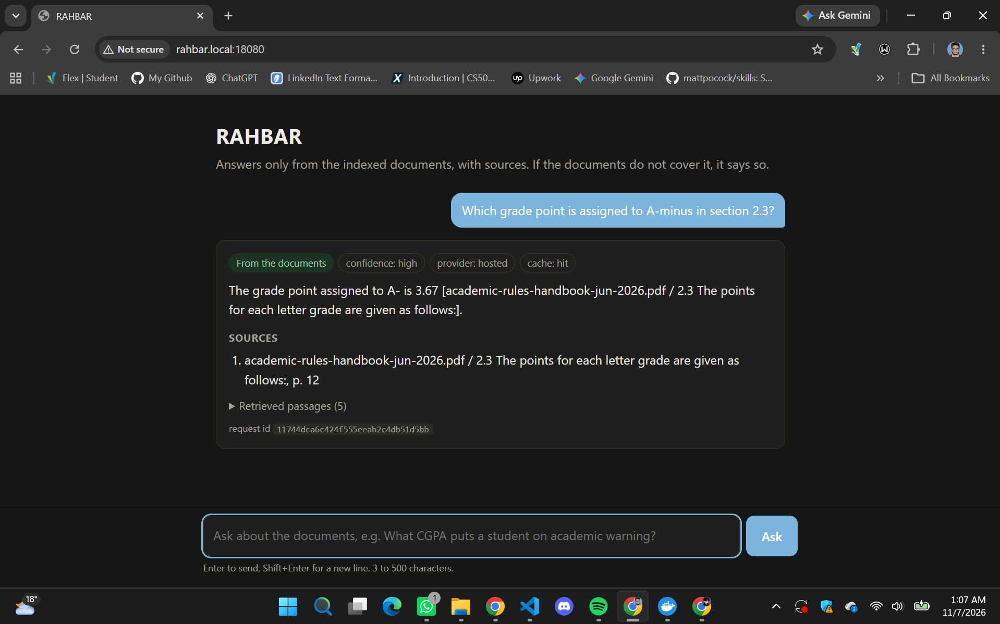
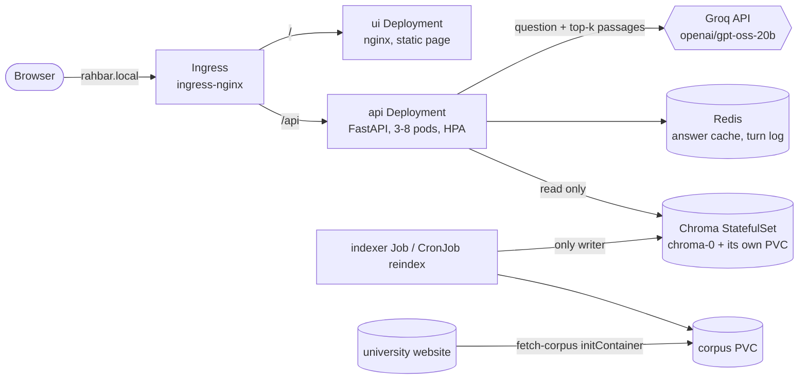

# RAHBAR

[](https://github.com/jojomojo707/rehbar-scd/actions/workflows/ci.yml)

RAHBAR answers questions about FAST-NUCES academic rules from the university's own documents,
and says so when it cannot. Students today search several PDFs (the 2026 academic rules
handbook, the student handbook, the prospectus, grading and fee pages) and often find an older
version of a rule first. RAHBAR retrieves the relevant passages from those documents, asks a
language model to answer only from them, cites the section each sentence comes from, refuses
to use superseded versions unless you ask about one, and declines questions the documents do
not cover (for example hostel allocation). It runs on Kubernetes (minikube) as CS4032
Assignment 02.



## Architecture



- **api** (`api/`): embeds the question locally, retrieves from Chroma (dense plus a light
  exact-term leg), applies a relevance floor, calls the model, validates the JSON answer and
  every citation, and caches the result in Redis keyed by the index version.
- **indexer** (`indexer/`): a Kubernetes Job, the only writer to Chroma. Extract (with OCR for
  scanned pages) → clean → structure-aware chunks of 480 tokens with 64 overlap → embed → store
  into a new `rahbar-v<timestamp>` collection, then switch the `rahbar-active` pointer
  (blue/green, so the API never sees a half-built index).
- **ui** (`ui/`): one static `index.html` served by non-root nginx.
- **Embeddings:** fastembed `BAAI/bge-small-en-v1.5`, 384 dimensions, downloaded into both
  images at build time, so nothing is fetched at runtime. Both the api and the indexer read the
  model name from the same ConfigMap key, `EMBED_MODEL`; the api refuses readiness if the index
  was built with a different one.
- **Generator:** Groq's OpenAI-compatible API with `openai/gpt-oss-20b` (`LLM_PROVIDER=hosted`).
  What leaves the cluster is in [ADR 0004](docs/adr/0004-llm-provider-and-data-governance.md).

Design details: [ARCHITECTURE.md](ARCHITECTURE.md), which routes to every file in
[docs/architecture/](docs/architecture/).

## Prerequisites

| Tool | Why |
| --- | --- |
| minikube (docker driver), 4 CPUs and 8 GB free | The local cluster. `make cluster` also enables Calico (NetworkPolicy), metrics-server (HPA, `kubectl top`) and ingress-nginx |
| Docker 23+ with buildx | Builds the three images |
| kubectl (with built-in kustomize) | `kubectl apply -k` |
| Python 3.12 and GNU make (bash) | Tests, the eval and the helper targets |
| A Groq API key | Generation. Free at console.groq.com. It goes only into the Kubernetes Secret |

## From a clean clone to an answered question

Run these in order from the repository root. **The order matters**: the namespace must exist
before the Secret, and the Secret before the api starts.

```bash
git clone https://github.com/jojomojo707/rehbar-scd.git && cd rehbar-scd
make install                                   # .venv for tests and eval
make cluster                                   # minikube + Calico + metrics-server + ingress
make images                                    # build the three images, load them into minikube
kubectl apply -f k8s/base/namespace.yaml       # the namespace must exist before the Secret
export LLM_API_KEY=<your Groq key>             # in your shell only, never in a file
make secret                                    # creates Secret rahbar-secret from $LLM_API_KEY
kubectl apply -k k8s/overlays/dev              # everything else; the indexer Job starts now
kubectl wait --for=condition=complete job/indexer -n rahbar --timeout=30m
kubectl rollout status deployment/api -n rahbar
make ask Q="What CGPA puts a student on academic warning?"     # a cited answer
make ask Q="How are hostel rooms allocated?"                    # declined: answered_from_context false
```

`make secret` runs exactly
`kubectl create secret generic rahbar-secret -n rahbar --from-literal=LLM_API_KEY="$LLM_API_KEY"`
(through `--dry-run=client -o yaml | kubectl apply -f -`, so it can be re-run). The only Secret
file in Git is `k8s/base/secret.placeholder.yaml`, which holds `REPLACE_ME` and is never applied.

**Delete a pod and lose nothing.** While asking questions in a loop, delete one api pod:

```bash
while true; do make ask Q="What is the minimum CGPA to graduate?" | grep -c citations; sleep 0.5; done
# in a second terminal:
kubectl delete $(kubectl get pod -n rahbar -l app.kubernetes.io/name=api -o name | head -n 1) -n rahbar
```

Every request keeps succeeding: the other pods serve while the Deployment replaces the
deleted one, and readiness keeps the new pod out of the Service until it can answer. Our run is
in [docs/evidence/pod-delete.txt](docs/evidence/pod-delete.txt).

**Open the UI.** Add `$(minikube ip) rahbar.local` to `/etc/hosts` and browse to
`http://rahbar.local/`. `make ask` does not need this, because it sends the `Host` header
itself. On macOS or Windows, run `minikube tunnel` in another terminal and pass
`INGRESS_IP=127.0.0.1` to `make ask`.

### Things that bit us

- **The first index takes about 22 minutes on a laptop** (OCR of the scanned pages, then about
  18 minutes of embedding at the Job's 2-CPU limit). The api pods stay not-ready until it
  finishes; that is readiness doing its job.
- **`make images` can leave an old image in minikube.** `minikube image load` sometimes keeps
  the previous `:dev` image. Building straight into minikube's Docker is reliable:
  `eval $(minikube docker-env) && docker build -t rahbar-api:dev api`, then
  `kubectl rollout restart deployment/api -n rahbar`.
- **A finished Job cannot be re-applied.** Its pod template is immutable, so after the indexer
  image changes run `kubectl delete job indexer -n rahbar --ignore-not-found` before
  `kubectl apply -k k8s/overlays/dev`. A clean clone never needs this.

## The documents (corpus)

The documents are **not committed**. The `fetch-corpus` initContainer of the indexer Job runs
`corpus/fetch.py`, which downloads every file listed in `corpus/sources.yaml` from the
university website (one at a time, with a pause) onto the corpus volume, then checks each
file's size and SHA-256 against the committed [corpus/MANIFEST.md](corpus/MANIFEST.md); a
mismatch fails the Job instead of indexing different bytes. To get them locally:
`make fetch`, then `python corpus/fetch.py --verify`. What each document is and why it is in
the corpus: [docs/CORPUS.md](docs/CORPUS.md).

## Running the indexer

The first index runs automatically: `kubectl apply -k k8s/overlays/dev` creates Job `indexer`.
To re-index later without a redeploy and without downtime, start a one-off Job from the weekly
CronJob `reindex`:

```bash
make index        # = kubectl create job --from=cronjob/reindex reindex-$(date +%s) -n rahbar
kubectl get jobs -n rahbar -w
```

The api keeps serving the old collection until the new one is complete, then switches within
`INDEX_REFRESH_SECONDS` (10 s). Its last log line, `indexer finished`, reports the chunk count
and storage amplification (`kubectl logs job/indexer -n rahbar -c indexer`). Pipeline details:
[docs/PIPELINE.md](docs/PIPELINE.md).

## API

The Ingress forwards only `/api/*` to the api. The health and metrics endpoints are on the
pod's port 8000 for the kubelet and Prometheus, not on the public host.

| Method | Path | Through the Ingress | What it does |
| --- | --- | --- | --- |
| POST | `/api/ask` | yes | Body `{"question": "...", "history": [...]}`. Returns the answer, its citations, the retrieved passages, `answered_from_context` and `cached`. `history` carries earlier turns for follow-up questions; the api uses the last 3 |
| GET | `/healthz` | no | Liveness: the process is alive. Touches no dependency |
| GET | `/readyz` | no | Readiness: Chroma reachable, active index complete, embedding model matches, Redis answers. `503` names the failed check |
| GET | `/metrics` | no | Prometheus metrics, e.g. `rahbar_request_seconds`, `rahbar_cache_lookups_total`, `rahbar_fallbacks_total`, `rahbar_inflight_requests` |

Contract and error mapping: [docs/architecture/interfaces.md](docs/architecture/interfaces.md).

## Development and CI

```bash
make test           # API and indexer unit tests (stubs only: no cluster, model or network)
make lint           # ruff and mypy
make dev            # the API with stub retriever and model on http://localhost:8000, plus the UI
make eval           # the 18-question golden set through the Ingress, with the CI gate
make check          # the submission checker
```

Every pull request runs `ci.yml`: lint, tests, manifest checks, the three image builds, a Trivy
scan of each, and `e2e-eval`, which deploys the stack into a kind cluster and fails if recall@5
drops more than 5 points below the baseline. Merging to `main` runs `cd.yml`: the tests again, then
the three images pushed to Docker Hub tagged with the commit SHA, then a deploy of exactly
those images into a fresh kind cluster with a smoke test through the Ingress. `main` needs one
approval and all ten checks.

## Further reading

| Document | What is in it |
| --- | --- |
| [ARCHITECTURE.md](ARCHITECTURE.md) | System overview, and why Chroma is a StatefulSet |
| [docs/adr/](docs/adr/) | ADRs: [0001 indexer as a Job](docs/adr/0001-indexer-as-job.md), [0002 chunking](docs/adr/0002-chunking.md), [0003 cache store](docs/adr/0003-cache-store.md), [0004 LLM provider and data governance](docs/adr/0004-llm-provider-and-data-governance.md), [0005 conversation history](docs/adr/0005-conversation-history-contract.md) |
| [docs/CORPUS.md](docs/CORPUS.md), [docs/PIPELINE.md](docs/PIPELINE.md) | The documents, and the indexing pipeline with its measurements |
| [docs/FAILURE-ANALYSIS.md](docs/FAILURE-ANALYSIS.md) | Four stages broken on purpose, and what showed each one |
| [docs/ENGINEERING-NOTES.md](docs/ENGINEERING-NOTES.md) | The seven engineering questions |
| [docs/evidence/](docs/evidence/) | `kubectl` output and screenshots behind every claim |
| [docs/AI-USAGE.md](docs/AI-USAGE.md) | Which AI tools wrote what, and what we changed |
