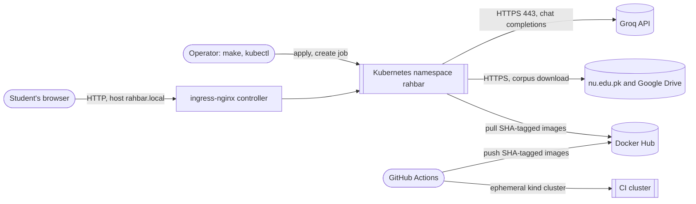
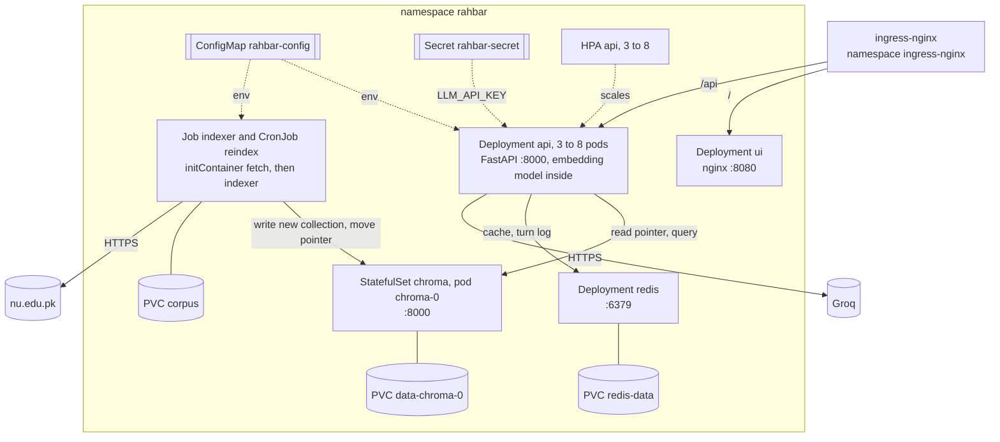

# System structure

The parts of RAHBAR, where they run, who may talk to whom, and who owns which data.
Per-component internals are in [components.md](components.md). Kubernetes object settings are in
[deployment.md](deployment.md).

## Context

| External party | Why RAHBAR talks to it | Direction |
| --- | --- | --- |
| Browser | Asks questions through the chat UI | In, via the Ingress |
| Groq | Generates schema-constrained answers ([D6](decisions.md#d6-groq-for-generation)) | Out, from the api |
| nu.edu.pk and Google Drive | Source documents ([D5](decisions.md#d5-corpus-delivered-by-an-initcontainer)) | Out, from the indexer's initContainer |
| Docker Hub | Image registry for SHA-tagged images | Pushed by cd.yml, pulled by clusters |
| GitHub Actions | CI and CD ([ci-cd.md](ci-cd.md)) | Runs its own ephemeral cluster |

## Runtime topology

## Two paths, one shared pin

From the RAG lecture: *indexing runs once, and again when the material changes; querying runs on
every question.*

| | Indexing path | Query path |
| --- | --- | --- |
| Runs as | Job `indexer`, CronJob `reindex` ([D1](decisions.md#d1-indexer-runs-as-a-job)) | Deployment `api` |
| When | On apply, weekly, or on demand | Every request |
| Chroma access | **Only writer**: creates collections, moves the pointer | **Read only**: pointer, metadata, queries |
| Redis access | None (forbidden by §4.7) | Read and write cache entries; append to the turn log |
| Embedding model | `EMBED_MODEL`, passage embeddings | `EMBED_MODEL`, query embeddings |
| Pin enforcement | Writes `embed_model` and `dimension` into the collection metadata | Refuses readiness on a mismatch ([Startup and readiness](workflows.md#startup-and-readiness)) |

The two paths share three things: the ConfigMap, the embedding model baked into both images, and
the collection metadata that records the pin.

## Data ownership

| Data | Writer | Readers | Where it persists | If it is lost |
| --- | --- | --- | --- | --- |
| Index collections `rahbar-v*` | indexer | api | PVC from Chroma's `volumeClaimTemplates` | API not ready; one re-index command restores it |
| Active pointer `rahbar-active` | indexer | api | Same PVC | Same as above |
| Cache entries | api | api | Redis PVC (append-only file) | Only latency; entries rebuild themselves |
| Turn log | api | operator (`redis-cli`) | Redis PVC, 7-day TTL | Only the audit trail; answers are unaffected (follow-up context lives in the browser) |
| Corpus files and `_index.json` | fetch initContainer | indexer | PVC `corpus` | Downloaded again on the next run |
| Configuration | operator (`kubectl`) | api, indexer | etcd (ConfigMap, Secret) | Re-apply the manifests; recreate the Secret |
| Logs | every container | operator | stdout only | Gone with the pod (by design, §4.8) |
| Evaluation results | `run_eval.py` | team, CI | Git (`eval/*.json`) | Re-run the evaluation |

## Connection matrix

This is the complete list of allowed connections. Anything not listed is denied.
[security.md § Network policy](security.md#network-policy) turns this matrix into NetworkPolicy
objects.

| # | From | To | Port | Purpose |
| --- | --- | --- | --- | --- |
| C1 | ingress-nginx | ui | 8080/TCP | Static chat page |
| C2 | ingress-nginx | api | 8000/TCP | `/api/*` requests |
| C3 | ui | api | 8000/TCP | Listed by §4.7. **Unused**: the browser, not the ui pod, calls the api (AMB-06) |
| C4 | api | chroma | 8000/TCP | Pointer, metadata, queries, readiness |
| C5 | api | redis | 6379/TCP | Cache, turn log, readiness |
| C6 | api | internet (Groq) | 443/TCP | Generation |
| C7 | indexer | chroma | 8000/TCP | Write collections, move pointer |
| C8 | indexer (initContainer) | internet (nu.edu.pk, Google Drive) | 80, 443/TCP | Fetch the corpus |
| C9 | every pod | kube-dns in `kube-system` | 53/UDP and TCP | Name resolution (§9) |
| C10 | kubelet (node) | every pod | Probe ports | Health probes |

**Explicitly denied**, and each one worth showing in evidence:

- ui to chroma (§4.7 names this one)
- ui to redis
- indexer to redis
- chroma to anything
- redis to anything

## Trust boundaries

| Input | Trust | Controls |
| --- | --- | --- |
| User question | Untrusted | Length validation, delimiting in the prompt ([security.md § Untrusted content](security.md#untrusted-content)) |
| Retrieved chunk text | Untrusted: documents can carry injected instructions | Delimiting, neutralising the delimiter tags, system rules, strict schema |
| Model output | Untrusted | Strict schema, Pydantic validation, citation filter, never executed ([validation-and-errors.md](validation-and-errors.md)) |
| Downloaded documents | Untrusted bytes | SHA-256 check against the committed manifest; parsed, never executed |
| Configuration and Secret | Trusted (operator) | Validated at start-up ([Configuration validation](validation-and-errors.md#configuration-validation)) |
