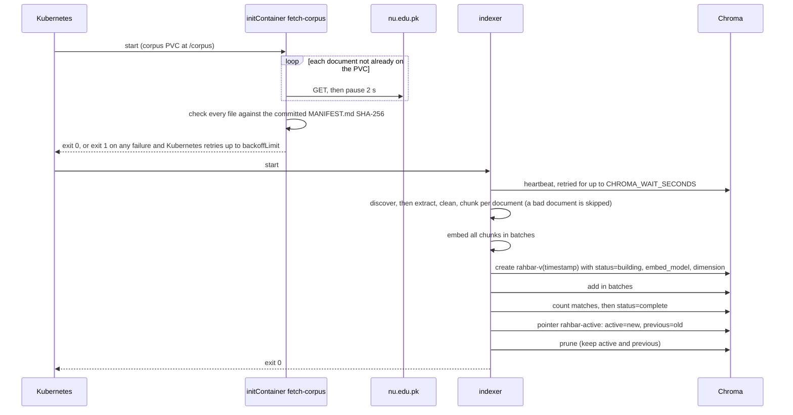
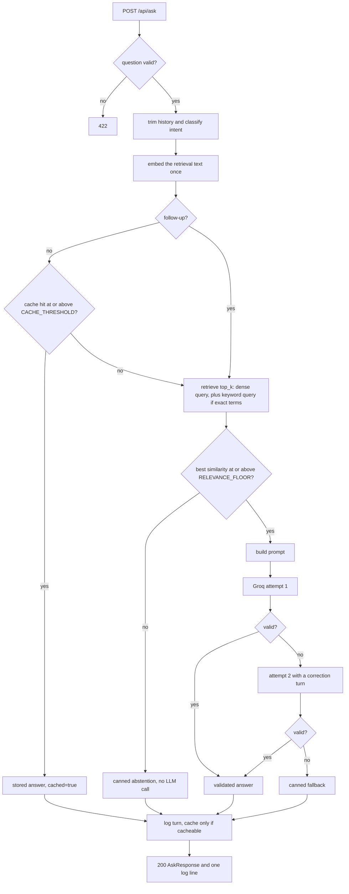
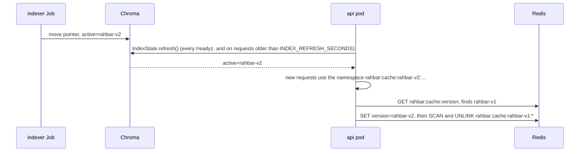

# Runtime workflows

How the parts behave over time: indexing, answering, caching, readiness, re-indexing, model
changes and rollouts. The rules each step applies are in
[validation-and-errors.md](validation-and-errors.md); the shapes are in
[data-models.md](data-models.md).

## Indexing run

The Job `indexer` and every run of the CronJob `reindex` follow these steps
([D1](decisions.md#d1-indexer-runs-as-a-job), [D2](decisions.md#d2-blue-green-re-index),
[D5](decisions.md#d5-corpus-delivered-by-an-initcontainer)).

| Stage | Rules | Module |
| --- | --- | --- |
| Discover | `_index.json` when present, otherwise Markdown front matter (given `run.py`) | `run.py` |
| Extract | **PDF:** pdfplumber text per page. Tables found by `extract_tables()` are rendered as Markdown tables in reading order, and the jumbled text in their area is dropped. **OCR:** a page with fewer than 25 non-space characters is rendered with pdf2image (300 dpi) and read with pytesseract (`eng`), and marked `ocr=True`; `OCR_ENABLED=false` skips this step. **HTML:** main content only (scripts, navigation and footers removed), headings become Markdown `#` lines, tables become Markdown tables. **Markdown:** front matter removed | `extract.py` |
| Clean | Unicode NFKC; join words hyphenated across a line break; collapse spaces; remove page-number-only lines and `Page x of y`; remove header and footer lines that repeat (after masking digits) in the first or last two lines of at least half the pages. **Kept on purpose:** clause numbering, heading lines, table pipes, line breaks before headings | `clean.py` |
| Chunk | Detect headings: numbered clauses `^\d+(\.\d+)*\.?\s+\S`, Markdown `#`, short all-capital lines. Pack each section into chunks of at most `CHUNK_SIZE` tokens, splitting first by paragraphs, then sentences, then tokens. Repeat the last `CHUNK_OVERLAP` tokens of the previous chunk inside the same section only. Keep tables whole, or split them by rows with the header repeated. Each chunk's text starts with its heading. `CHUNK_STRATEGY=fixed` ignores structure (stage B) | `chunk.py`, `tokens.py` |
| Embed | Passage embeddings from the baked `EMBED_MODEL`, in batches of 32 | `embed.py` |
| Store | Blue/green as in the diagram. Pin and build facts go into the [Collection metadata](data-models.md#collection-metadata) | `store.py` |

**The run's last log line, `indexer finished`,** carries `collection`, `chunks`, `documents`,
`skipped`, `original_tokens`, `stored_tokens`, `amplification` and `seconds`. PIPELINE.md takes
its numbers from this line.

## Query pipeline

One request to `POST /api/ask`. This covers the eight steps of §3.2, reordered so the embedding
happens before the cache check (AMB-03).

| Step (§3.2) | What happens | Module |
| --- | --- | --- |
| 1 Validate | [Input validation](validation-and-errors.md#input-validation). Keep the newest `HISTORY_MAX_TURNS` turns and shorten their answers to `HISTORY_ANSWER_MAX_CHARS` | `schemas.py` |
| (intent) | Set three flags. **Follow-up**: see [Follow-up questions](#follow-up-questions). **Explicit older version**: the question contains *old, older, previous, earlier, former, superseded, outdated, repealed* or *last year*, or a year matching a value in the collection's `superseded_versions`. **Exact terms**: clause numbers `\b\d+(\.\d+)+\b`, course codes `\b[A-Z]{2,4}-?\d{3,4}\b`, amounts `\b\d{1,3}(,\d{3})+\b`, percentages `\b\d{1,3}\s?%`, at most 3 terms | `query_intent.py` |
| 3 Embed (moved before 2) | One query embedding of the retrieval text, reused for the cache and for retrieval | `providers/embedding` |
| 2 Cache check | Skipped for follow-ups. Namespace = active index version, fingerprint and mode ([Redis keyspace](data-models.md#redis-keyspace)) | `cache.py` |
| 4 Retrieve | Dense query on the active collection, `n_results=TOP_K`. `where={"superseded": False}` unless the question explicitly asks about an older version or `SUPERSEDED_FILTER=false`. With exact terms and `HYBRID_RETRIEVAL=true`, a second query adds `where_document` `$contains`. Both lists are merged by RRF (score = Σ 1/(60 + rank)), and the top `TOP_K` are kept. `Passage.score` stays the cosine similarity | `retrieval/chroma.py`, `fusion.py` |
| (floor) | [Relevance floor and abstention](validation-and-errors.md#relevance-floor-and-abstention) | `answer.py` |
| 5 Augment | [Prompt contract](interfaces.md#prompt-contract) | `prompt.py` |
| 6 Generate | [Groq contract](interfaces.md#groq-contract) at `TEMPERATURE` | `providers/llm/hosted.py` |
| 7 Validate | [Output validation](validation-and-errors.md#output-validation), then [Retry and fallback](validation-and-errors.md#retry-and-fallback) | `validate.py`, `fallback.py` |
| 8 Store | Append the turn to the turn log; cache the answer when it is [cacheable](validation-and-errors.md#cacheability). Then write the [Request log line](observability.md#request-log-line) | `turns.py`, `cache.py` |

## Follow-up questions

([D4](decisions.md#d4-conversation-history-and-follow-ups))

1. **History from the browser.** The UI keeps the last `HISTORY_MAX_TURNS` turns of the tab in
   memory (a reload starts a new conversation) and sends them as `history`, each answer already
   shortened to `HISTORY_ANSWER_MAX_CHARS`. The API trims again in case a client sends more.
   `run_eval.py` and `curl` send none, so they never produce follow-ups.
2. **Follow-up test.** A question is a follow-up when **both** hold:
   - `history` is not empty, and
   - the question starts with *and, also, so, what about, how about, then, but* or *what if*, or
     one of its **first three words** is a referring word (*it, its, that, this, those, these,
     they, them*). Only the start of the question is checked, so "What is the fee that applies
     to MS students?" is not a follow-up. *There* is not a referring word, because "Is there a
     late fee?" is a new question.
3. **Retrieval for a follow-up.** The retrieval text is the last history question, a newline,
   then the new question. The prompt adds `<conversation_history>`
   ([Prompt contract](interfaces.md#prompt-contract)). Citations are still checked only against
   this request's retrieval.
4. **Not a follow-up.** The history is ignored completely: not embedded, not in the prompt. The
   answer therefore depends only on the question and can be cached safely.
5. **No cache.** Follow-ups skip both the cache lookup and the cache store (`X-Cache: SKIP`).
6. **Turn logged.** Every outcome, cached hits and follow-ups included, appends one turn to
   `rahbar:turns` ([Redis keyspace](data-models.md#redis-keyspace)). The list is trimmed to
   `TURN_LOG_MAX_ENTRIES` and its TTL renewed. A Redis error skips the log with a WARNING; the
   answer is still returned.

## Semantic cache

([D3](decisions.md#d3-redis-cache-with-versioned-keys))

**Lookup.**

1. Read the entry ids from the namespace's sorted set (at most `CACHE_MAX_ENTRIES`).
2. Fetch their vectors in one Redis pipeline.
3. Compute cosine similarity as the dot product of unit vectors.
4. The best entry is a **hit** if its similarity is at or above `CACHE_THRESHOLD`.

**Store.** Only when the answer is [cacheable](validation-and-errors.md#cacheability). Trim the
oldest entries beyond `CACHE_MAX_ENTRIES`.

**Invalidation when the index changes.**

- **Old answers can no longer be served** as soon as a pod sees the new pointer, because their
  keys carry the old version. Deleting them is clean-up, and TTLs back it up.
- **Several pods may run the clean-up at once.** That is harmless: deleting a key twice is a
  no-op.
- **A request still in flight during the switch** may write one entry under the old namespace.
  Nothing reads it, and the clean-up or its TTL removes it.

## Startup and readiness

1. **Start-up** (`main.py` lifespan):
   1. Validate the settings ([Configuration validation](validation-and-errors.md#configuration-validation)).
   2. Configure JSON logging.
   3. Load the embedder for `EMBED_MODEL` from `EMBED_CACHE_DIR`. On failure, record the problem
      (shown later as the `embedding_model` check) and keep running.
   4. Create the clients.
   5. Call `IndexState.refresh()` once and log the result.
   6. **Do not index anything.**
2. **Pin conflict at start-up.** Logged at ERROR:
   `{"msg": "embedding pin mismatch", "configured_model": …, "index_model": …, "configured_dimension": …, "index_dimension": …, "collection": …}`.
3. **`/readyz`** re-runs the checks on every probe, every 10 seconds
   ([HTTP endpoints](interfaces.md#http-endpoints)). A pin problem therefore also catches an
   index rebuilt with another model while the pod was running.
4. **`/healthz`** stays 200 throughout. A pod that is alive but not ready is withheld from the
   Service, not restarted. Readiness protects users; liveness protects the pod.

## Re-index and rollback

- **On demand (R-OPS-02):**
  `kubectl create job --from=cronjob/reindex manual-reindex-1 -n rahbar` (`make index` does the
  same with a timestamp in the name).
- **Weekly:** the CronJob `reindex` runs Sundays at 03:00 Asia/Karachi (default P7).
  `concurrencyPolicy: Forbid`.
- **What users notice:** nothing. The api keeps answering from the old collection until the
  pointer moves, then switches within `INDEX_REFRESH_SECONDS`. The cache moves to a fresh
  namespace at the same moment.
- **A failed run:** the pointer never moves. A half-written `building` collection is pruned by a
  later successful run.
- **Rollback:** no rollback command is built, because the brief does not ask for one. To go
  back to an older index, restore the old configuration in the ConfigMap and re-index. The
  previous collection is still kept (`KEEP_COLLECTIONS=2`), so pruning never leaves Chroma with
  only a half-written index.

## Changing the embedding model

**Planned change, with no downtime.** The order matters, because `maxUnavailable: 0` keeps the
old pods serving while new ones are not ready:

1. Make sure the new model is baked into both images, and deploy those images.
2. Change `EMBED_MODEL` in the ConfigMap.
3. `kubectl rollout restart deployment/api -n rahbar`. The first new pod reports **not ready**
   (pin mismatch against the old index), so the rollout pauses while the old pods keep serving.
4. Run a re-index. The new collection records the new pin, and the pointer moves.
5. The new pods become ready, the old pods become not ready, and the rollout completes.

**The §4.4 demonstration (R-OPS-09).** Do only steps 2 and 3, with a model name the index was not
built with. The new pod sits at `0/1 READY`, and its log shows the pin-mismatch line. Commands are
in [deployment.md § Operations and demos](deployment.md#operations-and-demos).

**Without this guardrail**, the API would embed questions with one model and search vectors from
another. Retrieval would return nonsense with no error anywhere (Engineering Note Q6).

## Rollout, scaling and pod loss

| Event | What happens |
| --- | --- |
| Rolling update (`set image`) | One extra pod is created (`maxSurge: 1`), and an old pod is removed only after the new one is ready (`maxUnavailable: 0`). Each old pod shuts down gracefully ([Rollout settings](deployment.md#rollout-settings)) |
| `rollout undo` | The same procedure back to the previous ReplicaSet |
| Load rises | The HPA adds pods (up to 8) at 70% CPU of the requested amount. The Service selector picks them up by label; `kubectl get endpoints` lists them |
| An api pod is deleted | The Service drops it at once; two others keep serving; the Deployment replaces it. **This is the "delete a pod" demonstration** |
| `chroma-0` is deleted | The StatefulSet recreates `chroma-0` on the **same** PVC, so no data is lost. Meanwhile every api pod fails `/readyz` (chroma), so the service is briefly unavailable (AMB-19) |
| The redis pod is deleted | Recreated on its PVC with the append-only file. The api is briefly unready, because §4.3 requires Redis to be reachable |
| Indexer OOMKilled | Exit code 137. The container restarts in place (`OnFailure`) up to `backoffLimit`; the pointer is untouched |
